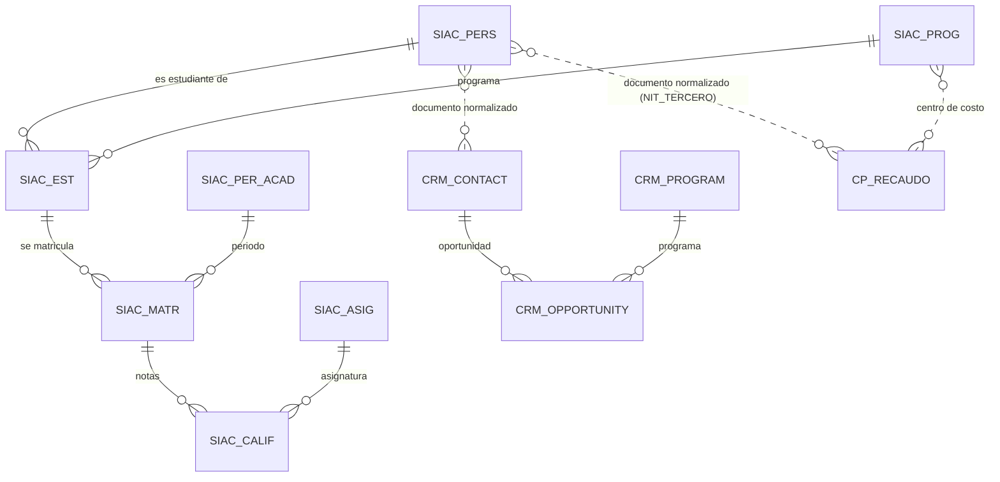
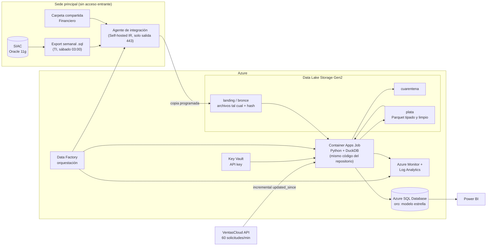

# Bodega de datos institucional — Diagnóstico, calidad, gobierno y arquitectura

**Prueba técnica Ingeniero(a) de Datos · Santiago Rodríguez Zapata · Octubre de 2026**

Fecha de corte de los datos: export SIAC del 17/10/2026, archivos de ContaPlus hasta septiembre de 2026 y
extracción del CRM VentasCloud del 24/10/2026.

Todas las cifras de este documento salen de una consulta SQL del repositorio. El identificador entre corchetes
(por ejemplo [S24]) es el nombre de la consulta dentro de `sql/profiling/`. Las conversaciones con las áreas y su
contraste con los datos están en [`docs/entrevistas.md`](entrevistas.md).

---

## Resumen para la Dirección

1. **Hoy la institución no puede responder con una sola cifra cuántos estudiantes tiene.** Para el semestre
   2026-2 hay cuatro respuestas: 612 (matrícula real en SIAC), 662 (campo de estado del SIAC), 671 (reporte de
   activos del SIAC) y la cifra de Comercial, que cuenta como estudiante a quien el asesor marcó como "ganado".
   Registro saca sus cifras oficiales a mano en Excel. Propuesta: una sola definición, con Registro como dueño.
2. **La meta comercial se mide en el CRM y el CRM no se valida contra la matrícula real.** El 86 % de las
   oportunidades "ganadas" se marca antes de que el estudiante se matricule, incluida la etapa "Matriculado",
   y 52 nunca se matricularon.
3. **Hay $428 millones en pagos sin identificar desde enero de 2025 y nadie tiene asignado aclararlos.** Además
   los archivos de Financiero se pueden editar después de exportarse (un mes no cuadra) y un mes se cargó dos
   veces ($84 millones duplicados si se suman los archivos).
4. **Siete datos o reglas no tienen dueño**: cada área remite a otra (modalidad virtual/presencial, autorización
   de datos personales, listado de estudiantes por convenio, paz y salvo para grado, entre otros). Son los
   primeros acuerdos que hay que cerrar.
5. **Sí se puede identificar a la misma persona en los tres sistemas** con el número de documento normalizado:
   en las 731 coincidencias entre SIAC y CRM el nombre también coincide. El problema es que al 23 % de los
   contactos del CRM le falta el documento.
6. La arquitectura propuesta en Azure respeta las limitaciones reales (SIAC sin acceso desde la nube, CRM con
   límite de 60 solicitudes por minuto, ContaPlus sin API) y es pequeña: los tres sistemas suman menos de 5 MB
   por carga.

---

## 1. Diagnóstico de fuentes

### 1.1 Inventario técnico

| | SIAC (Registro y Control) | VentasCloud (Comercial) | ContaPlus 3.2 (Financiero) |
|---|---|---|---|
| **Qué contiene** | Personas, estudiantes, programas, periodos, asignaturas, matrículas y notas | Contactos (leads), oportunidades por periodo de ingreso, catálogo de programas | Recaudos mensuales, cartera trimestral, conceptos de cobro |
| **Tecnología** | Oracle 11g R2 Standard Edition One, en el datacenter de la sede | SaaS en la nube | Software contable de escritorio, sin base de datos accesible |
| **Forma de conexión** | Export completo semanal en un script `.sql` de Oracle (DDL + INSERT + PL/SQL). Sin IP pública ni VPN | API REST, solo GET, header `X-API-Key`, paginación por cursor, filtro incremental `updated_since` | Archivos de texto exportados a mano a una carpeta compartida |
| **Estructura** | 7 tablas relacionales + 1 paquete PL/SQL con la vista de activos | JSON en camelCase; 3 endpoints | Texto `;`, codificación Windows-1252, montos `1.234.567,89`, encabezado de 3 líneas y pie con totales |
| **Volumen** | 2,9 MB. 967 personas, 804 estudiantes, 1.791 matrículas, 8.704 notas, 125 asignaturas, 7 programas, 6 periodos | 1,1 MB. 1.271 contactos, 1.240 oportunidades, 9 programas (13 páginas de 100) | 96 KB. 21 archivos de recaudos (3.317 filas), cartera (128 filas), 8 conceptos |
| **Frecuencia** | Semanal: corre el sábado 03:00 y se publica el domingo. Siempre completo, no incremental | Bajo demanda; el filtro `updated_since` permite traer solo lo cambiado | Mensual, en los primeros días del mes; cartera cada trimestre |
| **Restricciones** | Ventana de mantenimiento los domingos de 00:00 a 06:00. Cambios de mecanismo vía la Mesa de TI (10 días hábiles) | 60 solicitudes por minuto por llave (429 + `Retry-After`); CORS deshabilitado; máximo 100 registros por página; no informa registros borrados | Dos versiones del formato (v3.2 hasta junio de 2025 con 8 columnas; v3.2.7 desde julio de 2025 con 9 columnas y códigos nuevos) |
| **Dueño del dato** | Gloria Restrepo, Coordinadora de Registro y Control | Andrés Gaviria, Líder Comercial | Martha Lucía Zuluaga, Analista Contable |
| **Soporte técnico** | Mesa de servicio TI | Proveedor VentasCloud / Mesa de TI | Mesa de servicio TI |

**Decisión de carga del SIAC.** No se instaló Oracle. El script se interpreta con Python
(`src/extract/siac.py`): se leen el DDL, los comentarios de columnas y los INSERT, y cada fila se guarda como texto
en Parquet junto con el número de línea del script de donde salió. Razones: el export cambia cada semana y se
procesa completo; no ejecutar código PL/SQL de terceros; poder trazar cada fila a su línea de origen; y que el
mismo código corra en local y en la nube. La carga se valida contra los conteos que trae el propio export.

### 1.2 Cómo se relacionan las fuentes

Las líneas punteadas no existen en ningún sistema: se construyen en la bodega (sección 3.4).

Equivalencia de programas entre los tres sistemas [X07]:

| Programa institucional | SIAC | CRM | Centro de costo |
|---|---|---|---|
| Administración de Empresas | ADM01 (hasta 2025-1) y ADE10 (desde 2025-2) | VC-PRG-001 Virtual y VC-PRG-002 Presencial | 11010 |
| Contaduría Pública | CON01 | VC-PRG-003 | 11020 |
| Negocios Internacionales | NEG01 | VC-PRG-004 | 11030 |
| Mercadeo | MER01 | VC-PRG-005 | 11040 |
| Ingeniería Industrial | ING01 | VC-PRG-006 | 12010 |
| Esp. Gerencia de Proyectos | EGP01 | VC-PRG-007 | 21010 |
| Tecnología en Gestión Comercial | — | VC-PRG-008 (inactivo) | — |
| Diplomado en Analítica de Datos | — (no está en el SIAC) | VC-PRG-009 | Concepto 1160 / EXT |

### 1.3 Diccionario de datos de las entidades principales

Los tipos son los del sistema de origen. La columna "Observaciones" resume lo que se encontró al perfilar.

**SIAC_PERS — Persona** (aspirantes, estudiantes y egresados; una fila por persona)

| Campo | Tipo | Significado | Observaciones |
|---|---|---|---|
| ID_PERS | NUMBER(10) | Identificador interno | Una misma persona puede tener dos (37 documentos duplicados) |
| TIP_DOC | VARCHAR2(3) | CC, TI, CE, PPT | 105 personas con TI tienen 18 años o más: no se actualiza |
| NUM_DOC | VARCHAR2(20) | Número de documento | 25 % escrito con puntos (`1.000.050.268`). **Llave entre sistemas una vez normalizado** |
| PRI_NOM, SEG_NOM, PRI_APE, SEG_APE | VARCHAR2(60) | Nombres y apellidos | Tildes y mayúsculas inconsistentes |
| FEC_NAC | VARCHAR2(10) | Fecha de nacimiento, debería ser DD/MM/AAAA | Es texto: 66 vienen como MM/DD/AAAA; 15 vacías |
| EMAIL, TEL_CEL, MUNICIPIO | VARCHAR2 | Contacto y residencia | 34 correos repetidos; 55 variantes de municipio escritas a mano |
| FEC_REG, USU_REG | DATE, VARCHAR2 | Cuándo y quién la registró | `INSCRIPCION_WEB` identifica el formulario web |
| IND_ANUL | CHAR(1) | S = registro anulado | Debe filtrarse siempre |

**SIAC_EST — Estudiante** (una fila por persona y programa)

| Campo | Tipo | Significado | Observaciones |
|---|---|---|---|
| COD_EST | VARCHAR2(12) | Código: año + periodo + consecutivo | |
| ID_PERS, COD_PROG | | Persona y programa | |
| COD_PER_ING | VARCHAR2(6) | Periodo de ingreso | |
| EST_ESTADO | CHAR(1) | A activo, I inactivo, R retirado, G graduado | Se cambia a mano; 50 siguen "A" sin matrícula en 2026-2. **No sirve para contar activos** |
| FEC_GRADO | DATE | Fecha de grado | Solo marzo y septiembre (ceremonias) |
| IND_ANUL | CHAR(1) | Anulado | |

**SIAC_MATR — Matrícula académica** (una fila por estudiante y periodo). Hecho principal de Registro.

| Campo | Tipo | Significado | Observaciones |
|---|---|---|---|
| ID_MATR | NUMBER(10) | Identificador | |
| COD_EST, COD_PER, COD_PROG, NUM_SEM | | Estudiante, periodo, programa y semestre | |
| FEC_MATR | DATE | Fecha de la matrícula | |
| TIP_MATR | CHAR(1) | N nuevo, A antiguo, R reintegro | 6 "N" falsos por matrículas anuladas y vueltas a crear |
| EST_MATR | CHAR(1) | M matriculado, C cancelado | |
| IND_ANUL | CHAR(1) | Anulada | 23 pares anulada/válida del mismo estudiante y periodo |

**SIAC_CALIF — Calificación** (una fila por matrícula y asignatura)

| Campo | Tipo | Significado | Observaciones |
|---|---|---|---|
| NOTA_C1, NOTA_C2, NOTA_C3 | NUMBER(4,2) | Cortes al 30 %, 30 % y 40 % | |
| NOTA_DEF | NUMBER(4,2) | Definitiva, escala 0,0 a 5,0 | 24 mayores a 5 y 4 en -1; 43 no cuadran con 30/30/40 |
| IND_ANUL | CHAR(1) | Anulada | Las correcciones anulan la nota y crean otra (54 pares) |

**SIAC_PROG / SIAC_PER_ACAD — Programa y periodo**: código, nombre, nivel (P pregrado, E especialización),
código SNIES, número de semestres y estado; periodos con fecha de inicio y fin y un indicador de vigente (solo
2026-2). El periodo 2027-1 ya está creado.

**VentasCloud /contacts — Contacto (lead)**

| Campo | Tipo | Significado | Observaciones |
|---|---|---|---|
| contactId | texto | Identificador del CRM | |
| firstName, lastName | texto | Nombre | 187 en minúscula |
| email, mobile | texto | Contacto | 82 correos repetidos; celular en 4 formatos |
| documentType, documentNumber | texto | Documento | 289 sin documento (23 %): no es obligatorio en el formulario web |
| city | texto | Ciudad | Hasta 4 variantes por ciudad |
| programInterest | texto libre | Programa de interés | 39 variantes para 9 programas |
| leadSource | texto | Canal de llegada | 11 canales; incluye "Convenio empresarial" y "Visita presencial" |
| ownerName | texto | Asesor | |
| consentDataProcessing | booleano | Autorización de tratamiento de datos | 57 en falso, 30 de ellos con oportunidad ganada |
| createdAt, updatedAt | ISO 8601 | Fechas de creación y modificación | `updatedAt` es confiable para la carga incremental |

**VentasCloud /opportunities — Oportunidad**

| Campo | Tipo | Significado | Observaciones |
|---|---|---|---|
| opportunityId, contactId, programId | texto | Identificadores | |
| intakePeriod | texto | Periodo al que quiere ingresar (AAAA-S) | Mismo formato que SIAC |
| stage | texto | Etapa | 15 valores en inglés y español por un cambio de configuración a mitad de 2025 |
| amount, currency | número, texto | Valor de la oportunidad | Lo digita el asesor; 140 ganadas sin valor; el Diplomado con valores de pregrado |
| lostReason | texto | Motivo de pérdida | 83 perdidas sin motivo |
| createdAt, updatedAt, closedAt | ISO 8601 | Fechas | `closedAt` suele ser anterior a la matrícula real |

**ContaPlus recaudos_AAAA_MM.txt — Recaudo** (una fila por comprobante)

| Campo | Tipo | Significado | Observaciones |
|---|---|---|---|
| FECHA | DD/MM/AAAA | Fecha del pago | El mes real puede no coincidir con el nombre del archivo |
| COMPROBANTE | texto | Recibo de caja RC-nnnnnn | Consecutivo completo, sin huecos. **Llave natural** |
| NIT_TERCERO | texto | Documento de quien paga | 21 formatos; 999999999 = pago sin identificar; NIT de empresa en convenios |
| NOMBRE_TERCERO | texto | Nombre del pagador | 425 terceros con más de un nombre |
| CONCEPTO | texto | Código de cobro | Cambió en julio de 2025 (MAT → 1105, etc.) |
| CENTRO_COSTO | texto | Programa contable | Solo desde la versión v3.2.7 |
| DETALLE | texto libre | Descripción | Única fuente del periodo académico, en unas 20 redacciones |
| VALOR | `1.234.567,89` | Monto | 55 negativos (devoluciones y reversiones) |
| FORMA_PAGO | texto | PSE, consignación, tarjeta, etc. | |

**ContaPlus cartera_corte_AAAA_MM.txt — Cartera**: NIT y nombre del tercero, concepto, centro de costo, periodo,
fecha de vencimiento, valor facturado, abonado, saldo, días de mora y acuerdo de pago. Cuadra internamente; el
"TOTAL TERCEROS" del pie cuenta filas, no terceros (128 filas, 120 terceros).

---

## 2. Hallazgos de calidad

Cada hallazgo tiene su evidencia en una consulta del repositorio. La columna **Tipo** indica si se corrige en la
bodega (**Técnico**), si requiere un acuerdo con el área (**Acuerdo**) o ambas cosas. Las correcciones técnicas
no cambian los sistemas de origen: se aplican en la capa de limpieza y se informan al dueño del dato.

### 2.1 Hallazgos críticos (cambian una cifra que se reporta a la Dirección)

**H1. "Estudiante activo" tiene cuatro definiciones** · SIAC + CRM · [S24, S37, V03] · Tipo: Ambos

- *Evidencia.* Para 2026-2: matrícula válida = 612; `EST_ESTADO='A'` = 662; vista `VW_ESTUDIANTES_ACTIVOS` del
  paquete PL/SQL = 671. La vista suma la "reserva de cupo" (estudiantes matriculados el periodo anterior), no
  excluye matrículas canceladas o anuladas y, si hay dos periodos vigentes, toma el mayor. Comercial cuenta
  oportunidades ganadas. Registro calcula sus cifras a mano en Excel.
- *Impacto.* Una diferencia de hasta 59 estudiantes (10 %) en el indicador principal, según quién lo calcule.
- *Corrección técnica.* Una sola medida en la bodega: persona con matrícula `EST_MATR='M'` y no anulada en el
  periodo. Es lo que Gloria definió como activo ("tiene matrícula académica en el periodo, haya pagado o no").
- *Acuerdo.* Registro es el dueño de la definición. Se deja de usar la vista del SIAC y el campo de estado para
  contar. La Dirección ratifica que esta es la cifra oficial.

**H2. Las etapas "ganada" y "Matriculado" del CRM no significan matrícula** · CRM + SIAC · [V03, X04] · Tipo: Acuerdo

- *Evidencia.* De las oportunidades ganadas que cruzan con una matrícula en SIAC, el 86 % (464 de 537) se cerró
  antes de la matrícula, con una mediana de 8 días. La etapa "Matriculado" se comporta igual (165 de 216 antes) y
  52 ganadas nunca se matricularon. Andrés confirma que los asesores cierran cuando el aspirante paga la
  inscripción o "dice que sí", y que la meta se mide con el CRM. No existe ningún aviso de Registro a Comercial.
- *Impacto.* El indicador de la meta comercial está inflado y no se puede auditar.
- *Corrección técnica.* La conversión se calcula en la bodega: oportunidad ganada **y** matrícula válida en SIAC
  en el mismo periodo, cruzando por documento.
- *Acuerdo.* La etapa "Matriculado" la actualiza un proceso automático desde SIAC (no el asesor). La meta se mide
  con la matrícula de SIAC atribuible a una oportunidad.

**H3. $428 millones en pagos sin identificar, sin proceso ni responsable** · ContaPlus · [F06, F09b] · Tipo: Acuerdo

- *Evidencia.* 53 pagos con NIT 999999999 ($283M) y 27 con NIT vacío ($145M), casi todos de matrícula. Ninguno
  aparece aclarado después: las 55 reversiones son de personas identificadas. Martha deja los pagos así
  "mientras se aclaran", pero no sabe quién los aclara ni en cuánto tiempo.
- *Impacto.* Estudiantes que pagaron figuran como deudores o sin pago; el recaudo por programa queda incompleto.
- *Corrección técnica.* Se cargan como "tercero no identificado" y se reportan en un tablero de pendientes.
  Se proponen candidatos cruzando valor, fecha y programa con las matrículas sin pago.
- *Acuerdo.* Un responsable en Financiero, un plazo (30 días) y un registro de la aclaración en ContaPlus.

**H4. Un mes cargado dos veces y un archivo editado a mano** · ContaPlus · [F01, F02, F03] · Tipo: Ambos

- *Evidencia.* El archivo de abril de 2026 trae 88 recibos de marzo (RC-020264 a RC-020351) idénticos a los del
  archivo de marzo: $84.358.900 se suman dos veces. Martha explica que se reabrió el cierre de marzo y volvió a
  exportar. En noviembre de 2025 el total del pie dice $7.602.000 y el detalle suma $6.352.000: alguien editó el
  archivo (Martha recuerda "un ajuste manual"), aunque la nota de la carpeta dice que los totales "siempre cuadran".
- *Impacto.* El recaudo total queda sobrestimado y los archivos no son confiables como evidencia contable.
- *Corrección técnica.* Quitar duplicados por número de comprobante, asignar el mes por la fecha del recibo y no
  por el nombre del archivo, y validar en la carga que el detalle sume lo mismo que el pie: si no cuadra, el
  archivo va a cuarentena y se avisa a Martha. Guardar una huella (hash) de cada archivo recibido.
- *Acuerdo.* La carpeta de origen queda de solo lectura para todos menos la exportación; los ajustes se hacen en
  ContaPlus y se vuelve a exportar con un sufijo de versión (`recaudos_2026_03_v2.txt`).

**H5. Personas duplicadas y documentos en formatos distintos** · SIAC, CRM, ContaPlus · [S03, S04, G02, C03, V05, F05] · Tipo: Ambos

- *Evidencia.* SIAC: 37 documentos con dos personas (el formulario web crea una y el auxiliar crea otra al
  matricular); 25 % de los documentos con puntos. CRM: 82 correos repetidos, de los cuales 70 corresponden a la
  misma persona entrando por canales distintos (cada asesor crea a mano el lead de su canal). ContaPlus: el NIT
  viene en 21 formatos y 2.014 valores distintos se reducen a 939 al normalizarlos.
- *Impacto.* Conteos inflados de aspirantes y estudiantes, y cruces fallidos entre sistemas.
- *Corrección técnica.* Normalización del documento y tabla de identidad única (sección 3.4).
- *Acuerdo.* Buscar por documento antes de crear una persona (SIAC) o un contacto (CRM).

**H6. Matrículas sin pago y pagos sin matrícula** · SIAC + ContaPlus · [X05, X06, V07, F16] · Tipo: Ambos

- *Evidencia.* Entre 52 y 86 matriculados por periodo no tienen un pago de matrícula con su documento, y hay 58
  pagos de matrícula ($291M) de personas sin matrícula en ese periodo. La primera parte se explica con lo que
  dijeron las áreas: la matrícula académica va antes del pago (Gloria), hay financiación en tres cuotas y
  descuentos del 10 % y 15 % (Martha), y los convenios los paga la empresa sin decir qué estudiantes cubre. En los
  datos se ven pagos de exactamente 90 %, 85 %, 40 % y 30 % de la tarifa del programa.
- *Impacto.* Un indicador ingenuo de "matriculados sin pago" acusaría de morosos a estudiantes al día.
- *Corrección técnica.* Medir "al día" contra las cuotas vencidas de la cartera, no contra el pago total, y
  separar a los estudiantes cubiertos por convenio.
- *Acuerdo.* Que cada cuenta de cobro de convenio traiga el listado de documentos de los estudiantes (hoy no
  existe en ningún sistema).

### 2.2 Otros hallazgos

| # | Fuente | Hallazgo y evidencia | Impacto | Corrección técnica | Acuerdo con el área |
|---|---|---|---|---|---|
| H7 | SIAC | ADM01 y ADE10 son el mismo programa: cambió el código por la renovación del registro calificado en 2025-2 [S30] | Administración aparece partida en dos | Programa institucional homologado en la dimensión, conservando el código SIAC | Registro valida la tabla de homologación |
| H8 | SIAC | 23 pares de matrículas anuladas y vueltas a crear; 6 generan "nuevo" falso [S16, S36] | Doble conteo si no se filtra la anulación | Filtrar `IND_ANUL`; "nuevo" = primera matrícula válida de la persona | — |
| H9 | SIAC | 24 notas mayores a 5 (45 por 4,5) y 4 en -1; la corrección con acta no siempre llega al sistema [S20] | Promedios y aprobación distorsionados | Notas fuera de 0–5 a cuarentena y reporte a Registro | Registro corrige con el acta; TI agrega una validación de rango en el SIAC |
| H10 | SIAC | 43 definitivas difieren entre 0,2 y 0,5 de 30/30/40, regla que Registro confirma [S21] | Definitiva no reproducible | Recalcular y marcar la diferencia | Registro revisa los 43 casos |
| H11 | SIAC | Fecha de nacimiento como texto: 66 en MM/DD/AAAA, ambiguas cuando el día ≤ 12 [S05, S06] | Edad errónea | Leer el formato y marcar las ambiguas | TI cambia el campo a tipo fecha |
| H12 | SIAC | 105 personas con TI mayores de edad [S35] | El tipo de documento no sirve como llave | La llave usa solo el número | Actualizar el tipo al matricular |
| H13 | SIAC | Estado del estudiante desactualizado: la depuración "no siempre se hace a tiempo" [S37] | Activos sobrestimados si se usa el estado | Derivar el estado de la matrícula | Depuración al cierre de cada periodo |
| H14 | ContaPlus | Cambio de versión en julio de 2025: códigos nuevos sin tabla de equivalencia [F00, F07] | Series de recaudo por concepto rotas | Detectar la versión por el encabezado y homologar (MAT→1105, INS→1110, CER→1130, HAB→1140, REC→1150, EXT→1160, OTR→1199) | Martha valida la tabla |
| H15 | ContaPlus | El periodo académico solo está en el texto libre del detalle (unas 20 redacciones; 206 sin guion) [F10] | No se puede asignar el pago a un semestre sin interpretar texto | Extracción con expresiones regulares y marca de "sin periodo" | Formato fijo del detalle: `MATRICULA 2026-2` |
| H16 | ContaPlus | 5 graduados con saldo pendiente ($29,5M) [X08]; Registro dice que el paz y salvo es de Financiero y Financiero dice que es de Registro | Riesgo de cartera irrecuperable | Alerta en la bodega | Paz y salvo financiero como requisito de grado |
| H17 | CRM | Etapas en inglés y español (15 valores) por un cambio de configuración a mitad de 2025 [C07, V01, V02] | Embudo partido en dos | Tabla de homologación de etapas | TI migra las etapas viejas en VentasCloud |
| H18 | CRM | 23 % de contactos sin documento; 15 % aun con oportunidad ganada [C02, V04] | No se pueden cruzar con SIAC ni Financiero | Cruce secundario por correo y celular | Documento obligatorio al pasar a "Inscrito" |
| H19 | CRM | 233 oportunidades abiertas de periodos ya iniciados, 62 de 2025-1; no hay regla [C09] | Embudo inflado | Marcar como vencidas en la bodega | Cierre automático como perdida 30 días después del inicio del periodo |
| H20 | CRM | Monto digitado a mano: 140 ganadas sin valor; el Diplomado con montos de pregrado ($5–8M) cuando cuesta $1,2M [C11, F17] | Proyección de ingresos errónea | Valor desde la tarifa del programa | El monto lo pone el sistema, no el asesor |
| H21 | CRM | 57 contactos sin autorización de datos personales, 30 ganados; nadie sabe dónde se pide [C13] | Riesgo legal (Ley 1581 de 2012) | Excluirlos de usos de mercadeo en la bodega | Dueño del consentimiento (sección 3.5) |
| H22 | CRM | Programa de interés en texto libre (39 variantes) y modalidad solo en el catálogo del CRM [C06, X07] | Análisis por programa y modalidad incompletos | Homologación por texto | Lista desplegable en el formulario; dueño de la modalidad |
| H23 | Cruce | Entre 10 % y 17 % de los estudiantes nuevos no están en el CRM; desde 2025-2 casi todos son de convenio [X03, V07] | La meta comercial no se compara con el total de Registro | Excluir convenios de la atribución | Registrar en el CRM los ingresos por convenio y por visita |

---

## 3. Propuesta de gobierno de datos

El objetivo es que tres personas que ya hacen su trabajo puedan asumirlo sin crear una oficina nueva. Todo se
documenta en el mismo repositorio de la bodega (glosario, reglas y acuerdos en Markdown) y se revisa en una
reunión corta al mes. Herramientas de catálogo como Microsoft Purview quedan para una segunda fase.

### 3.1 Roles

| Rol | Quién | Responsabilidad |
|---|---|---|
| Patrocinador | Dirección de Transformación Digital | Ratifica definiciones, resuelve lo que no tiene dueño y prioriza |
| Dueño del dato | Gloria (académico), Andrés (comercial), Martha (financiero) | Aprueba las definiciones de su dominio y decide las correcciones de fondo |
| Gestor del dato (steward) | Una persona de cada equipo (auxiliar de Registro, coordinador de asesores, Martha) | Atiende las alertas de calidad de su dominio y corrige en el sistema de origen |
| Custodio técnico | Mesa de servicio TI | Exports, configuración del SIAC y del CRM, accesos |
| Ingeniería de datos | Transformación Digital | Construye la bodega, mide la calidad, publica los indicadores y documenta el linaje |

**Comité de datos**: 45 minutos al mes con los tres dueños, TI e ingeniería de datos. Agenda fija: tablero de
calidad del mes, acuerdos pendientes, cambios en los sistemas de origen.

### 3.2 Definiciones de negocio comunes

| Término | Definición | Fuente oficial | Dueño |
|---|---|---|---|
| Aspirante (lead) | Persona registrada en el CRM con interés en un programa | VentasCloud | Comercial |
| Inscrito | Aspirante que pagó los derechos de inscripción (concepto 1110/INS) | ContaPlus | Financiero |
| **Estudiante matriculado (activo) en un periodo** | Persona con matrícula académica `M` no anulada en ese periodo, haya pagado o no | SIAC | Registro |
| Estudiante nuevo | Matriculado cuya primera matrícula válida en la institución es la de ese periodo | SIAC | Registro |
| Conversión comercial | Oportunidades ganadas con matrícula válida en SIAC en el mismo periodo ÷ oportunidades del periodo | CRM + SIAC | Comercial (meta) / Registro (matrícula) |
| Estudiante de convenio | Matriculado cuya matrícula paga una empresa con convenio | ContaPlus + listado del convenio | Financiero |
| Recaudo | Valor de los comprobantes de caja por fecha del recibo, sin duplicados y neto de devoluciones | ContaPlus | Financiero |
| Estudiante al día | Sin cuotas vencidas en la cartera al corte | ContaPlus | Financiero |
| Graduado | Estudiante con fecha de grado registrada | SIAC | Registro |
| Programa institucional | Programa académico homologado (ADM01 + ADE10 = Administración de Empresas) | SIAC + tabla de homologación | Registro |

### 3.3 Reglas de calidad

Se evalúan en cada carga. Las que bloquean detienen la publicación de esa fuente; las demás generan alerta.
El resultado queda en una tabla de calidad y en un tablero mensual por dueño.

| Regla | Fuente | Acción | Avisa a |
|---|---|---|---|
| La suma del detalle es igual al total del pie del archivo | ContaPlus | Bloquea el archivo (cuarentena) | Martha |
| Un comprobante aparece en un solo archivo | ContaPlus | Se conserva una vez; alerta | Martha |
| El export trae los conteos de filas que declara | SIAC | Bloquea la carga | TI |
| Nota entre 0 y 5 | SIAC | Cuarentena del registro | Registro |
| Definitiva igual a 30/30/40 (±0,1) | SIAC | Alerta | Registro |
| Documento presente y válido (tras normalizar quedan solo dígitos, sin valores comodín como 999999999) | Las tres | Alerta | Dueño de la fuente |
| Una persona por documento normalizado | SIAC, CRM | Alerta con la lista de duplicados | Registro, Comercial |
| Pago con tercero identificado | ContaPlus | Tablero de pendientes con antigüedad | Financiero |
| Etapa dentro del catálogo homologado | CRM | Alerta | Comercial |
| Oportunidad ganada con matrícula en SIAC dentro de 30 días | CRM + SIAC | Alerta | Comercial |
| Contacto con autorización de datos | CRM | Excluido de usos de mercadeo | Comercial |
| Frescura: la fuente llegó en su ventana (SIAC el domingo, ContaPlus antes del día 10, CRM cada día) | Las tres | Alerta | Dueño y TI |

### 3.4 Identificar a la misma persona en los tres sistemas

No hay un identificador común, pero el número de documento funciona como llave cuando está: en las 731
coincidencias entre SIAC y CRM por documento normalizado, el nombre también coincide [X01, X02].

**Normalización del documento** (función única, usada para las tres fuentes):

1. Quitar el prefijo de tipo (`CC`, `CE`, `TI`) y los espacios.
2. Para personas, quitar el dígito de verificación que viene después de un guion (`1036…-5`).
3. Dejar solo dígitos y quitar los ceros a la izquierda.
4. Excluir los valores que no son una persona: `999999999` y NIT de empresa (9 dígitos que empiezan por 8 o 9).
5. No usar el tipo de documento en la llave: 105 personas siguen con TI siendo mayores de edad.

**Emparejamiento por niveles:**

| Nivel | Regla | Confianza | Uso |
|---|---|---|---|
| 1 | Documento normalizado igual | Alta | Automático |
| 2 | Correo normalizado igual y primer apellido igual | Media | Automático, marcado |
| 3 | Celular normalizado (10 dígitos) y primer apellido igual | Media | Automático, marcado |
| 4 | Solo nombre | Baja | No se une; va a una lista de revisión |

**Resultado:** una tabla de identidad (`persona_xref`) con un identificador institucional por persona y una fila
por cada registro de origen (sistema, identificador de origen, documento normalizado, regla que lo unió). Para los
datos de la persona se toma: nombre y documento de SIAC; correo y celular del registro actualizado más
recientemente; si la persona solo existe en el CRM, los datos del CRM. Nada de esto modifica los sistemas de
origen.

### 3.5 Acuerdos propuestos con cada área

**Registro y Control (Gloria)**
1. La cifra oficial de matriculados sale de la bodega con la definición de la sección 3.2 y reemplaza el Excel
   manual. Registro la valida cada periodo antes de publicarla.
2. Antes de crear una persona en el SIAC se busca por documento; los duplicados de la alerta se fusionan cada mes.
3. Depurar el estado de los estudiantes al cierre de matrículas de cada periodo.
4. Validar la tabla de homologación de programas y revisar las notas en cuarentena con el acta.

**Comercial (Andrés)**
1. La meta de matriculados nuevos se mide con matrícula en SIAC atribuible a una oportunidad del CRM.
2. La etapa "Matriculado" la actualiza la bodega desde SIAC; el asesor solo marca "Ganada".
3. Documento obligatorio cuando la oportunidad pasa a "Inscrito"; buscar el contacto antes de crearlo.
4. Oportunidades abiertas de un periodo ya iniciado se cierran como perdidas a los 30 días con motivo "periodo
   vencido".

**Financiero (Martha)**
1. Exportaciones sin edición manual: los ajustes se hacen en ContaPlus y se reexporta con sufijo de versión.
2. Responsable y plazo de 30 días para aclarar los pagos con NIT 999999999.
3. El detalle de los recibos de matrícula usa un formato fijo con el periodo (`MATRICULA 2026-2`).
4. Validar la tabla de equivalencia de códigos viejos y nuevos.

**Mesa de servicio TI**
1. Publicar el export semanal en una ubicación de la nube (sección 4) y, en una segunda fase, instalar un agente de
   integración en la sede.
2. Migrar las etapas en inglés del CRM y agregar validaciones de rango y formato en el SIAC.

**Temas sin dueño que se elevan a la Dirección** (cada área remite a otra; ver
[`docs/entrevistas.md`](entrevistas.md)):

| Tema | Propuesta de dueño |
|---|---|
| Cifra oficial de estudiantes (CRM frente a Excel de Registro) | Registro |
| Modalidad virtual o presencial (solo existe en el catálogo del CRM) | Registro, como atributo del programa |
| Autorización de tratamiento de datos personales | Comercial la captura; TI la custodia |
| Aviso de matrícula de Registro a Comercial | Automático desde la bodega |
| Listado de estudiantes por convenio empresarial | El área de convenios, con copia a Financiero |
| Paz y salvo financiero para grado | Financiero lo emite; Registro lo exige |
| Aclaración de pagos sin identificar | Financiero |

---

## 4. Arquitectura objetivo en Azure

### 4.1 Diagrama

### 4.2 Por qué estos componentes

El volumen es pequeño (menos de 5 MB por carga, unos miles de filas al mes) y el equipo es reducido. Por eso
se descartan plataformas de cómputo distribuido como Databricks o Synapse dedicado: costarían más y serían más
difíciles de mantener que el problema que resuelven.

- **Data Lake Storage Gen2**: guarda los archivos originales sin modificar (evidencia y reproceso) y las capas
  intermedias en Parquet. Es barato y es donde llegan los archivos de la sede.
- **Data Factory**: orquesta, programa y reintenta. Su agente de integración (Self-hosted Integration Runtime) se
  instala en un servidor de la sede y **solo abre conexiones de salida** por el puerto 443, así que no contradice
  la política de TI de no permitir conexiones entrantes desde la nube.
- **Container Apps Jobs con Python y DuckDB**: ejecuta las mismas transformaciones que corren en local en este
  repositorio. Se paga por segundo de ejecución. Si el volumen creciera, las mismas consultas SQL se pueden mover
  a otro motor.
- **Azure SQL Database (serverless)**: capa oro con el modelo estrella, que es lo que consume Power BI. Se apaga
  sola cuando no se usa.
- **Key Vault**: guarda la API key de VentasCloud; los procesos la leen con identidad administrada y nunca queda
  en el código.

*Alternativa evaluada:* Microsoft Fabric (lakehouse + pipelines + Power BI en un solo servicio). Es razonable si
la institución ya tiene capacidad de Fabric contratada; el diseño por capas es el mismo y el código Python/SQL se
puede trasladar.

### 4.3 Ingesta de cada fuente según sus limitaciones

| Fuente | Limitación real | Cómo se ingiere |
|---|---|---|
| **SIAC** | Sin IP pública ni VPN; export completo semanal; mantenimiento los domingos 00:00–06:00; cambios vía TI en 10 días hábiles | **Fase 1 (sin pedir nada nuevo a TI salvo una carpeta):** TI deja el `.sql` donde ya lo publica y el agente de integración lo copia a bronce el domingo a las 07:00, después de la ventana de mantenimiento. El job interpreta el script, valida los conteos y reemplaza la foto completa en plata; como el export es completo, se compara con la semana anterior para detectar altas, cambios y bajas. **Fase 2 (solicitud a TI):** el mismo agente lee el Oracle directamente con consultas de solo lectura, sin esperar el export. |
| **VentasCloud** | API de solo GET, 60 solicitudes/min, máximo 100 por página, sin CORS y sin aviso de registros borrados | Job diario con `updated_since` igual a la última marca de agua menos una hora de traslape, `page_size=100`, lectura del cursor hasta que llegue vacío y espera cuando `X-RateLimit-Remaining` se agota o llega un 429 con `Retry-After`. Una carga completa toma 27 solicitudes, muy por debajo del límite. Una vez por semana se hace una carga completa para detectar registros borrados. |
| **ContaPlus** | Sin base de datos ni API; exportación manual mensual a una carpeta; dos versiones de formato; archivos editables | El agente copia los archivos nuevos de la carpeta a bronce (disparador por llegada y verificación el día 10). En la carga se detecta la versión por el encabezado, se lee en Windows-1252, se valida el pie y se calcula una huella; si el archivo ya existía con otra huella, se carga como nueva versión y se avisa. Los recibos se deduplican por comprobante. |

### 4.4 Capas de la bodega

| Capa | Contenido | Reglas |
|---|---|---|
| **Bronce (landing)** | Archivos y respuestas de API tal como llegaron, particionados por fecha de carga | Inmutable. Nunca se borra ni se edita; permite reprocesar |
| **Cuarentena** | Archivos o registros que fallaron una regla que bloquea | Se revisan con el dueño del dato |
| **Plata** | Tablas tipadas y limpias: documentos normalizados, fechas convertidas, catálogos homologados (programas, conceptos, etapas), duplicados resueltos, tabla de identidad `persona_xref` y marcas de calidad por fila | Cada fila conserva su origen |
| **Oro** | Modelo dimensional para análisis | Solo datos aprobados por las reglas |

**Modelo estrella de la capa oro** (implementado en el bonus; el diagrama y las instrucciones están en el
[README](../README.md)):

- Dimensiones: persona (identificador institucional), programa institucional, periodo académico, fecha,
  concepto de cobro y canal comercial.
- Hechos: matrícula (una fila por persona, programa y periodo), recaudo (una por comprobante), oportunidad
  (una por oportunidad) y calificación.

### 4.5 Orquestación

| Proceso | Cuándo | Depende de |
|---|---|---|
| Copia y carga del SIAC | Domingo 07:00 | Publicación del export |
| Extracción incremental del CRM | Todos los días 05:00; completa el domingo | — |
| Carga de ContaPlus | Al llegar un archivo; verificación el día 10 de cada mes | — |
| Identidad de personas y capa oro | Después de cualquier carga exitosa | Las tres fuentes en plata |
| Actualización de Power BI | Al terminar la capa oro | Oro |

Si una fuente falla, las demás siguen y el tablero muestra la fecha de corte de cada fuente.

### 4.6 Monitoreo

- Data Factory y los jobs envían sus registros a Log Analytics; las fallas generan una alerta por correo o Teams
  a ingeniería de datos.
- Cada ejecución escribe en una tabla de control: fuente, archivo o página, filas leídas, filas cargadas, filas en
  cuarentena, duración y resultado.
- Los resultados de las reglas de calidad (sección 3.3) se guardan por ejecución y alimentan el tablero mensual
  de cada dueño.
- Alertas de frescura: si el export del SIAC no llega el domingo o el archivo de ContaPlus no llega antes del
  día 10, se avisa al dueño y a TI.

### 4.7 Trazabilidad desde el origen hasta el reporte

Cada fila de plata y oro conserva el archivo de origen, la línea dentro del archivo (o la página de la API), la
fecha de carga y el identificador de la ejecución. En este repositorio ya se hace así: las columnas `_src_file`,
`_src_line` y `_loaded_at` vienen desde la primera lectura.

Ejemplo: un recaudo que aparece en Power BI lleva su número de comprobante; con él se llega a la fila de plata,
de ahí al archivo `recaudos_2026_04.txt` guardado en bronce con su huella y a la línea exacta del archivo que
Martha exportó. Los informes muestran la fecha de corte de cada fuente.

### 4.8 Seguridad y datos personales

Acceso por grupos de Entra ID con mínimo privilegio, API key en Key Vault, cifrado en reposo y en tránsito, y en
Power BI seguridad por filas para que cada área vea su dominio. Los datos personales (documento, correo,
celular) solo se exponen a quien los necesita, y los contactos sin autorización de tratamiento de datos se
excluyen de los usos de mercadeo, conforme a la Ley 1581 de 2012.

---

## Uso de herramientas de IA

Usé un asistente de IA skill de RedmeIa de google geminis e integrando a cursos como apoyo durante toda la prueba para asi poder desarrollar 3 puntos claves que para mi parecer son muy acertados para poder tener un gran apollo durante la realizacion de la prueba, no solo lo tome como realizacion de la prueba si no tambien como lo puedo usar en mi dia a dia: 
- **Código**: generar borradores de los extractores en Python (interpretación del export Oracle, lectura de
  ContaPlus, cliente de la API con paginación y límite de solicitudes) y de las consultas SQL de perfilado.
  Revisé y ejecuté cada consulta; varias se corrigieron al ver los resultados (por ejemplo, el reenvío de
  `page_size` con el cursor de la API y cifras que estaban mal calculadas).
- **Entrevistas**: preparar las preguntas para las áreas y contrastar cada respuesta con los datos antes de la
  siguiente pregunta. Las preguntas se escribieron con mi estilo y se enviaron una a una.
- **Redacción**: ordenar los hallazgos y redactar este documento.

Las decisiones de definición, gobierno y arquitectura las tomé yo a partir de la evidencia, y cada cifra del
documento se puede reproducir con las consultas del repositorio.
